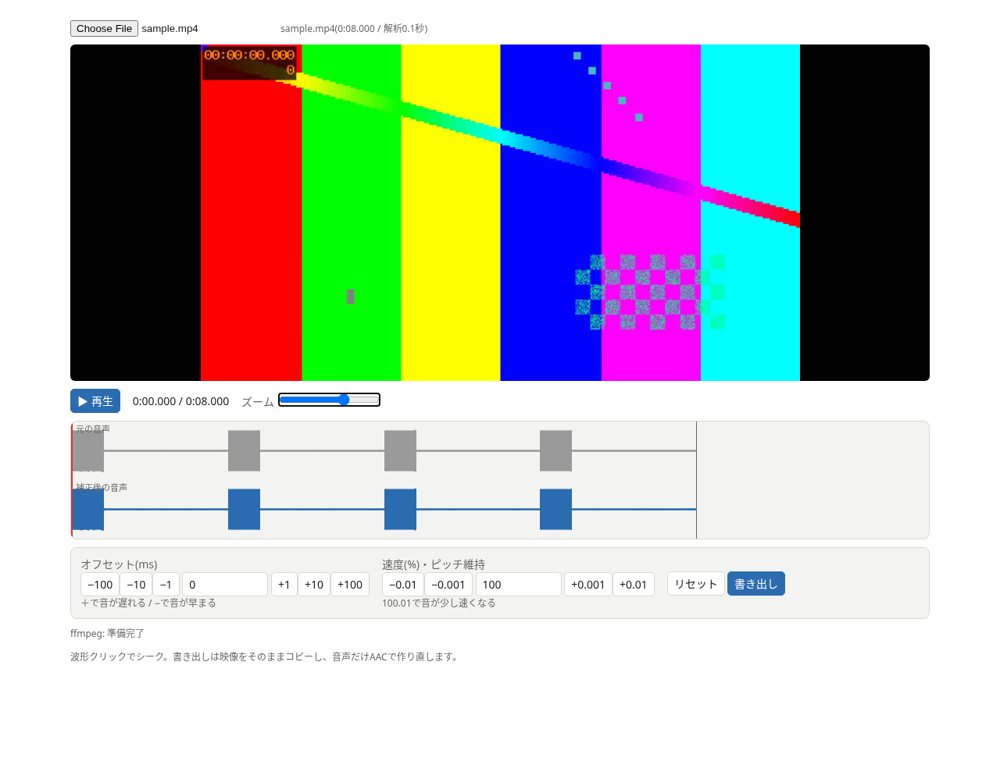
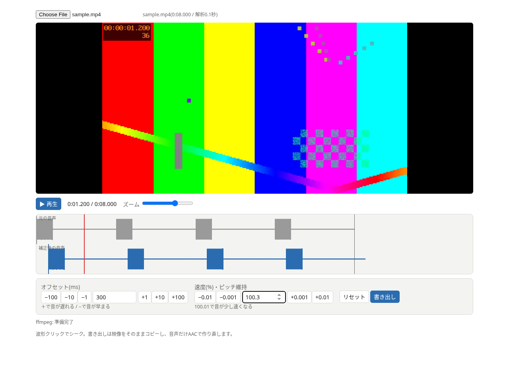

# 音ズレ補正

MP4の「音ズレ」（映像と音声のタイミングのずれ）を、ブラウザだけで直すツールです。
単一のHTMLファイルで動き、動画ファイルが外部サーバーに送信されることはありません。





## 何ができるか

- **オフセット補正** ― 音声全体を ms 単位（±1ms から）で前後にずらせます
- **速度補正（ドリフト補正）** ― 音声の速度を 0.001% 刻みで変えられます（ピッチは維持）。「最初は合っているのに、だんだんズレが広がる」タイプの音ズレに対応します
- **波形タイムライン** ― 元の音声と補正後の音声を2段の波形で見比べながら調整できます。ズームとクリックでのシークに対応
- **プレビュー再生** ― 動画を基準クロックにして音声を同期再生するので、ズレを耳で確認しながら詰められます
- **書き出し** ― 映像は再エンコードせずそのままコピーし、音声だけを AAC で作り直した MP4（`*_synced.mp4`）をダウンロードします

## 使い方

1. `index.html` をブラウザで開きます（後述のとおり `file://` では書き出し用 ffmpeg が動かないため、ローカルサーバー経由が確実です）
2. MP4ファイルを選ぶと、波形が解析されます（ドラッグ＆ドロップでも読み込めます）
3. 再生しながら、オフセット（ms）と速度（%）を調整します
4. 「書き出し」を押すと、補正済みの MP4 がダウンロードされます

手持ちの動画がなくても試せるよう、サンプル動画を用意しています（`samples/` フォルダ。公開サイトではボタンから直接読み込めます）。

- **サンプル1** ― 音が約500ms遅れている動画。オフセット −500ms で合います
- **サンプル2** ― 時間が進むほどずれが広がる動画。速度を約98.04%にすると合います

ローカルサーバーでの開き方:

```bash
python3 -m http.server 8000
# ブラウザで http://localhost:8000/ を開く
```

## 仕組み

- **波形の高速化** ― Web Audio API で音声を 8kHz にデコードしてピーク（200点/秒）を抽出します。長い動画でも解析が軽く、波形は見えている範囲だけを Canvas に描きます
- **プレビューの同期** ― `<video>` をマスターにし、`<audio>` の現在位置と再生レートを細かく追従させます（レートの微調整でドリフトを吸収）。ピッチは `preservesPitch` で維持します
- **書き出し** ― ffmpeg.wasm（@ffmpeg/core 0.12.6）を自前の Web Worker の中で実行します。UI をブロックせず、映像コピー＋音声フィルタ（`atempo` / `adelay` / `atrim`）で処理するため、音声だけの再エンコードで済みます。シングルThread版コアを使うので、COOP/COEP ヘッダ等のサーバー設定は不要です
- **ffmpeg コアの取得順** ― 同じ場所に置かれた `ffmpeg-core.js` / `ffmpeg-core.wasm` → jsDelivr CDN → unpkg CDN の順に試します。同梱すればオフラインに近い環境でも動きます

## 注意点

- 対応形式は MP4 のみです
- 長編・大容量のファイルでは、ブラウザのメモリ制限に当たる場合があります
- `file://` で直接開くと Worker と ffmpeg の読み込みに失敗します。ローカルサーバー経由で開いてください

## ライセンス

MIT
